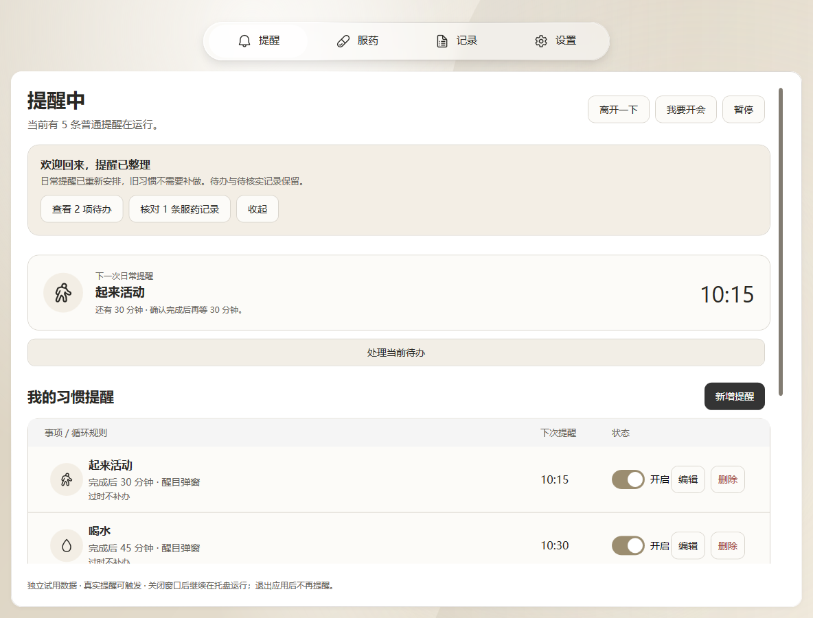
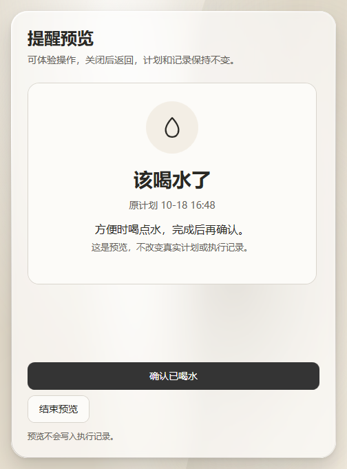
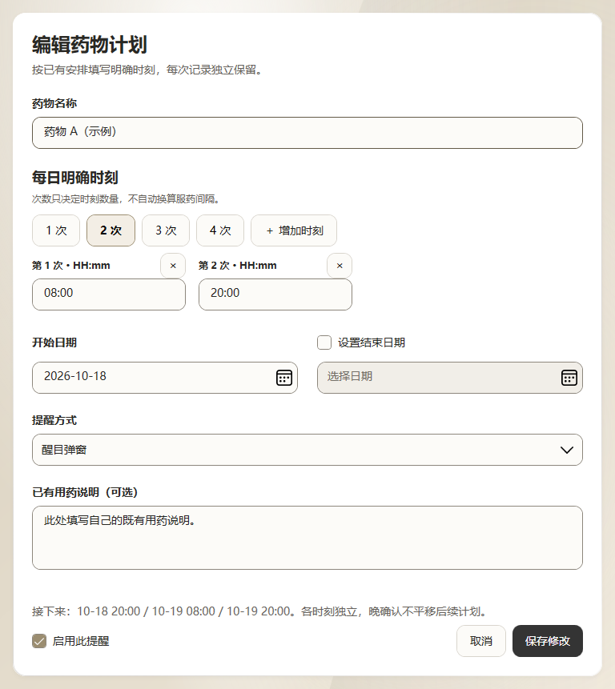
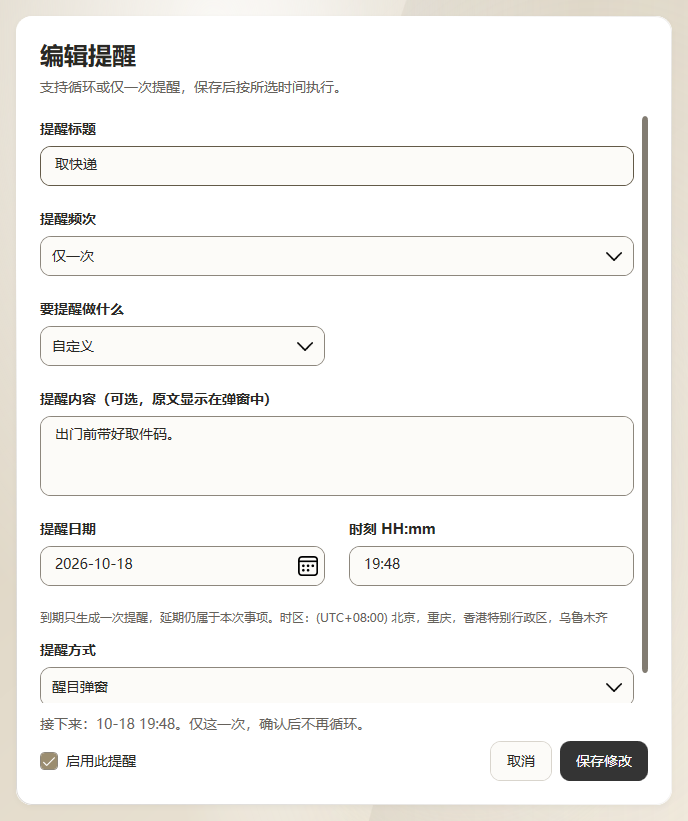
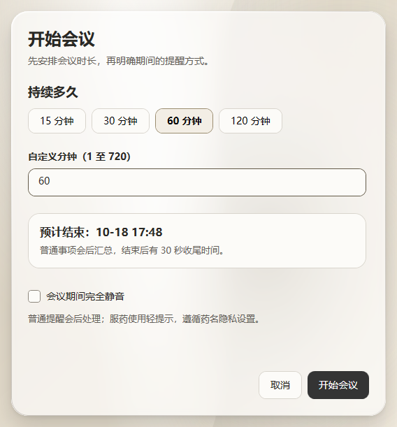
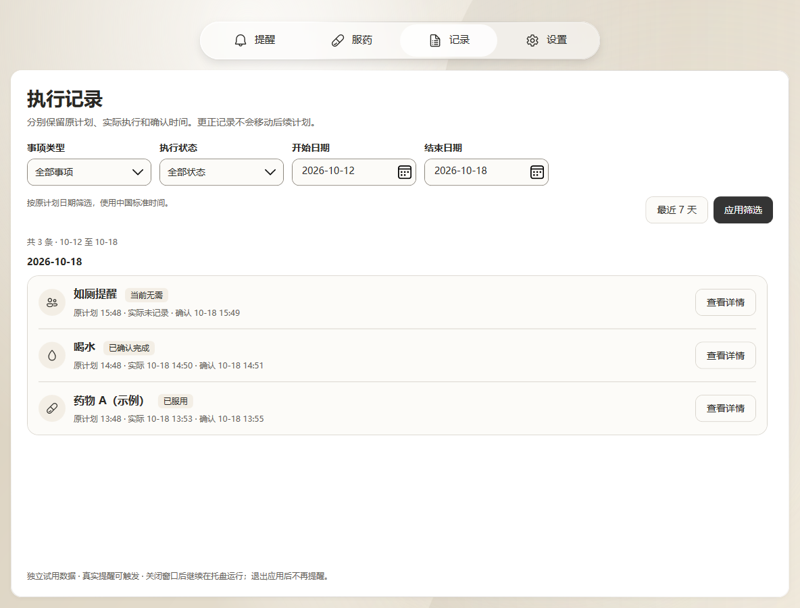
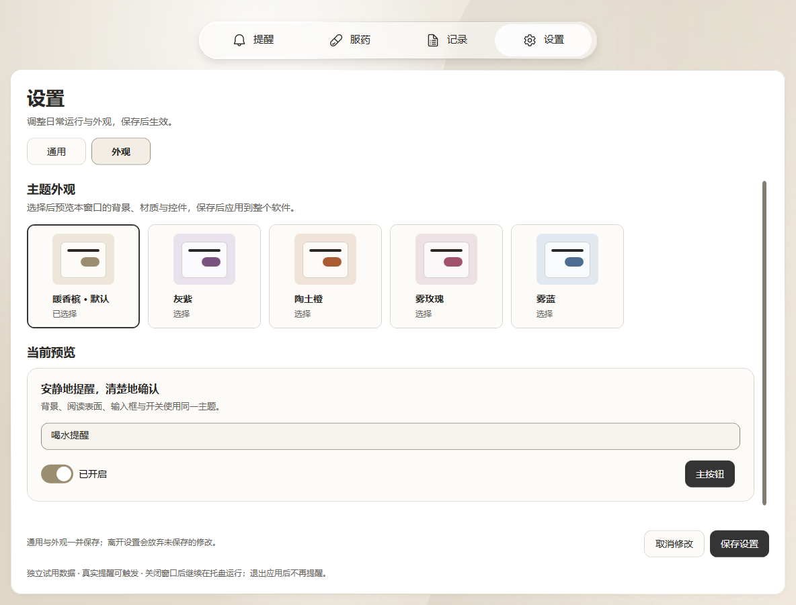
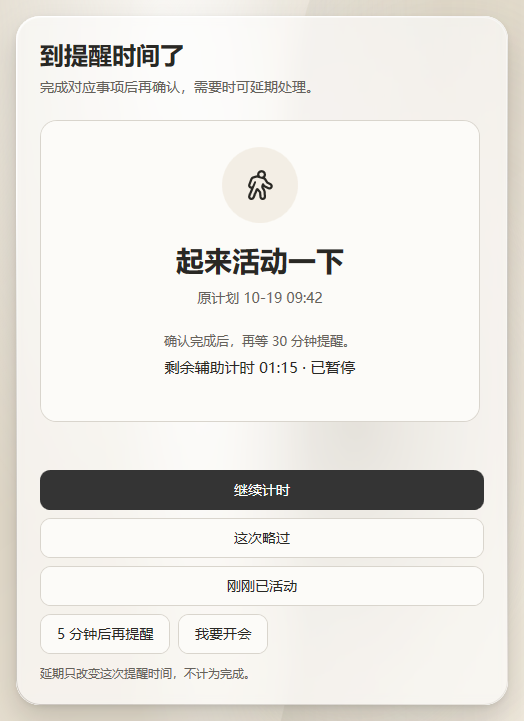
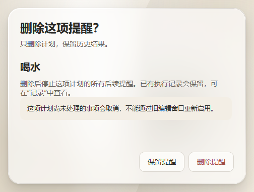

# 间歇 Pausewell

**给长时间坐在电脑前的人，一款提醒喝水、起身、服药和临时事项的 Windows 桌面工具。**

工作或学习一投入，就容易忘记喝水、一直坐着，甚至错过原本安排好的服药时间。间歇把这些小事变成可持续的提醒：到时间提示，处理后继续下一轮；开会不方便时，可以先暂缓，会后再处理。

## 适合谁

| 使用场景 | 遇到的问题 | 间歇能做什么 |
| --- | --- | --- |
| 长时间专注的上班族、开发者、设计师和学生 | 忙起来忘了喝水、起身或如厕，一坐就是很久 | 为每件事单独设置循环提醒，确认完成后再计算下一次 |
| 经常开会、演示或需要连续专注的人 | 提醒到了，却不方便立刻执行 | 手动进入会议模式或暂时暂停，会后继续处理待办 |
| 已有固定服药安排的人 | 不同药物时刻不同，事后又记不清是否确认过 | 为每个药物设置明确时刻，分别保留执行和确认记录 |
| 容易忘记零散小事的人 | 取快递、打电话等临时事情只需要提醒一次 | 创建指定日期和时刻的一次性事项，写下需要做的内容 |

## 它能帮你做什么

- **循环提醒日常小事**：喝水、起来活动、如厕，也可以自定义事项名称和内容。每条独立启停、设置规则和提醒方式。
- **按完成时间继续下一轮**：例如间隔 30 分钟的喝水提醒，10:10 确认完成，下一次就是 10:40。
- **照顾临时安排**：一次性事项在指定时刻提醒，完成后结束，不再循环。
- **管理明确的服药时刻**：按自己的既有安排填写每天的时刻与起止日期。各次记录独立保留，晚确认不会把后续计划整体推迟；不确定时可保留待核实状态。
- **适应开会与忙碌**：手动进入会议模式或暂停普通提醒，结束后留出收尾时间，再处理待办。
- **离开后自然继续**：主动离席或较长中断后，重新安排日常习惯，不要求补做过时提醒；短暂锁屏保留未来时刻，返回时用一条摘要说明结果。
- **分清习惯与待办**：习惯过时不补办，待办可以持续保留或设置有效截止；超过截止明确记为已过期，不算完成。
- **活动计时由自己控制**：支持开始、暂停、短中断后继续，也可确认刚刚已活动或略过本次；计时结束不会自动记录完成。
- **删除不再需要的提醒**：习惯、待办和服药计划都可删除，删除前说明影响，已有执行及待核实记录保留。
- **选择合适的提醒强度**：轻提醒、醒目弹窗或全屏提醒；可以确认完成或稍后提醒，全屏模式保留紧急退出入口。
- **回看执行记录**：筛选历史，查看原计划、实际执行和确认时间，需要更正时保留原因。
- **按自己的偏好使用**：五种主题，本地保存计划与记录，无需注册账号；关闭主窗口后可驻留托盘，退出应用后停止提醒。

## 界面演示

以下均为 Beta 程序实际运行截图，使用独立的虚构数据。主界面、活动继续与删除确认来自 v0.4.0，其余演示图来自 v0.3.10。喝水弹窗来自软件自带预览，不含真实服药或个人记录。

<table>
  <tr>
    <td width="50%"><strong>醒目提醒</strong> 把当前要做的事放到眼前，处理后继续下一轮。 </td>
    <td width="50%"><strong>独立药物计划</strong> 为不同药物填写各自的每日时刻与说明。 </td>
  </tr>
  <tr>
    <td><strong>一次性事项</strong> 为取快递等临时事情设置一次提醒。 </td>
    <td><strong>会议模式</strong> 需要开会时先暂缓普通提醒，结束后再处理。 </td>
  </tr>
  <tr>
    <td><strong>执行记录</strong> 分清计划时间、实际执行和确认时间。 </td>
    <td><strong>主题换肤</strong> 暖香槟、灰紫、陶土橙、雾玫瑰和雾蓝。 </td>
  </tr>
  <tr>
    <td><strong>中断后继续活动</strong> 保留已计时时长，由本人选择继续、确认或略过。 </td>
    <td><strong>删除不再需要的提醒</strong> 删除前说明影响，停止后续提醒并保留历史记录。 </td>
  </tr>
</table>

## 怎样开始

1. 创建需要的提醒，选择循环、每日时刻或仅一次。
2. 选择提醒方式，保存并启用。以后打开软件会自动恢复已启用的计划。
3. 正常工作，收到提醒后确认或稍后处理；开会前可先开启会议模式。

当前为 **Windows Beta**，实际办公稳定性、多屏等场景仍在验证，尚未发布正式安装发行版。开发者可以按[开发说明](docs/development.md)构建运行。

[开发与构建](docs/development.md) · [贡献规范](CONTRIBUTING.md) · [版本记录](CHANGELOG.md) · [反馈问题](https://github.com/ScauYjj/Pausewell/issues)
