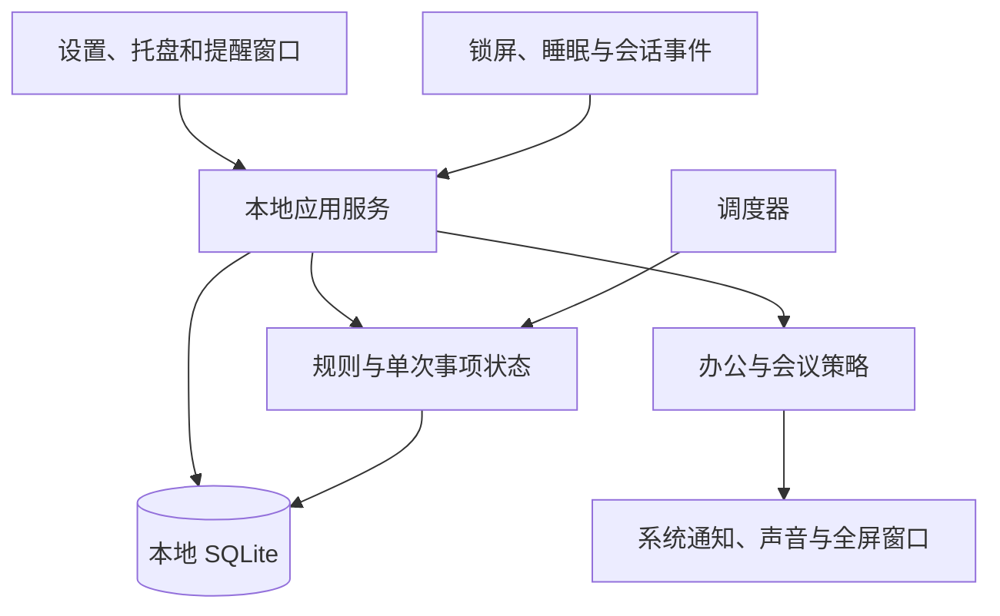

# 桌面健康习惯提醒软件：产品与实施方案评估

日期：2026-10-15
状态：方案建议，尚未进入开发或真实用户验证
平台：用户已确认先做 Windows，验证有效后再扩展

## 1. 核心判断

产品可以实现，建议定位为“面向办公人群、支持情境切换的桌面习惯提醒工具”。核心价值是让用户在合适的时机采取行动，并如实记录处理结果。全屏弹窗只是其中一种交互方式。

用户已表达的真实问题包括：专注工作时忘记照顾身体；普通提示容易被忽略；不同事项需要不同频次；会议等场景无法立即执行；提醒关闭以后需要继续可靠运行。

仍待验证的是：提醒能否提升长期执行率；什么强度会导致用户直接退出软件；现有工具的缺口是否足以支持一个独立产品。需求真实不等于商业需求已验证，软件也不能据此承诺改善具体疾病。

首版建议：Windows 常驻托盘、本地离线、多事项、固定时刻与完成后间隔提醒、可选全屏、手动会议模式、明确的完成与延期记录。普通习惯与服药使用不同默认策略。

## 2. 对基础需求的拆解

| 用户表述 | 实际痛点 | 产品响应 |
|---|---|---|
| 一坐下就忘了喝水、活动等 | 专注任务占用了对身体需求的注意力 | 托盘常驻、预告和分级提醒 |
| 提醒后还是继续工作 | 可以瞬间清除的通知缺乏行动约束 | 明确执行动作、活动计时、可选强提醒 |
| 每半小时提醒 | “每隔多久”缺少起点和暂停规则 | 明确按完成时间、固定时刻或电脑使用时段计算 |
| 不同药物每天两次或三次 | 每种药独立，频次还需要具体时刻 | 独立药物计划、逐次确认、实际时间记录 |
| 开会时没法执行 | 提醒与当前情境冲突 | 有期限的会议模式、隐私显示和会后恢复 |
| 完成后再循环 | 事项处理结果决定后续计划 | 持久化状态、下一次预览、重启恢复 |

不能把所有事项都默认绑定到同一个半小时闹钟。可以在同一界面展示同时到期的事项，但喝水、活动、如厕、服药仍需分别处理。如厕可设为“检查是否有需要”，不能把按时如厕当作必须完成的考核。喝水量、药量与用药频次均由用户依据自己的实际要求配置，软件不生成通用医疗方案。

## 3. 现有方案与产品差异

已核实的官方资料：

- [Stretchly](https://hovancik.net/stretchly/about/) 提供休息提醒、闲置处理和暂停等能力；其[官方仓库](https://github.com/hovancik/stretchly)列出全屏与严格模式配置。
- [Workrave](https://workrave.org/docs/breaks/) 提供微休息、长休息、每日电脑使用限制，并区分活跃时间与闲置时间。

这些产品说明“桌面强提醒与休息安排”已有成熟先例。这次有限范围查阅不能证明市场上没有符合全部要求的产品，也不能据此判断其他产品完全不支持某项功能。

可验证的差异方向：多类个人事项共存；服药计划与普通习惯分开处理；会议后有节制地恢复；用户可理解的循环规则；可靠的未完成与不确定状态。开发前可短期试用已有工具，记录具体缺口，避免重新实现已有能力却没有改善使用效果。

三条路线的取舍：

| 路线 | 优点 | 代价 | 建议 |
|---|---|---|---|
| 使用现有软件组合 | 能迅速缓解部分痛点 | 配置分散、缺少统一记录与策略 | 可用于建立使用基线 |
| 定制 Windows 单机版 | 贴近当前办公环境，范围可控 | 平台迁移需要额外工作 | 首选 |
| 直接做跨平台与手机协同 | 覆盖离开电脑后的情境 | 账号、推送、同步、权限显著增加复杂度 | 验证有效后再做 |

## 4. 提醒规则必须先于界面确定

### 4.1 三种时间模型

| 模型 | 示例 | 下一次如何确定 | 建议范围 |
|---|---|---|---|
| 完成后间隔 | 09:37 确认喝水，间隔 30 分钟 | 下一次 10:07；延期不当作完成 | 首版 |
| 固定时刻 | 每天 08:00、13:00、20:00 | 每个时刻生成独立事项；本次晚处理不自动平移后续计划 | 首版 |
| 累计电脑使用时段 | 使用电脑约 30 分钟后安排活动 | 依据闲置、锁屏和工作时段策略累计 | 第二阶段，可先用简单间隔替代 |

固定锚点每半小时提醒与“完成后再等半小时”也不同。如果将来支持前者，应单独命名并显示未来几次的实际时刻。

“每天两次”不能自动等同于“每隔 12 小时”。首版对每日两次或三次的药物，要求用户填写明确时刻及已有用药说明；严格间隔型用药另设规则并单独验证，不偷偷转换。饭前饭后说明可先作为人工录入的备注，真正按用餐事件触发的计划后续再做。

### 4.2 每个提醒事项的配置

事项名称与类别、启用开关、循环模型、间隔或时刻、适用日期、起止日期、有效时间段、提醒方式、声音、延期选项、完成方式、会议策略、隐私选项。

创建和修改页面必须显示“按照当前设置，接下来会在何时提醒”。普通习惯可默认只在办公时段生效；服药不自动继承办公时段、午休或周末停用规则。修改规则默认只影响未来事项，历史确认记录保留。

### 4.3 单次事项与显示尝试分离

一条计划会产生多次独立事项，同一事项又可能被提醒多次。“再次弹窗”不能生成新一剂药，也不能把上一次的延期算成已完成。

单次处理状态建议包括：待处理、进行中、延期、已确认完成、已明确跳过、待核实。显示状态另外记录：待展示、已请求展示、交互已发生、展示失败。窗口成功打开不能当作用户已经看见。

普通习惯延期后仍是原事项；完成后才能按对应规则生成或计算下一次。药物支持“已服用”“暂时无法处理”“确认未服用”“不确定是否服用”，其中只有明确确认才能写入已服用。

电脑重启、日期变化或提醒过期不能自动把药物事项变为已服用，也不能擅自判定下一步应该补服。[NHS SPS](https://sps.nhs.uk/articles/advising-on-missed-or-delayed-doses-of-medicines/)指出，延迟和漏服处理需要查具体药品说明等资料，后续两次服药过近也可能增加风险。因此软件只保留计划、实际记录和用户已有的处理说明，不自动给出补服或改剂量建议。

## 5. 提醒强度与完成机制

| 级别 | 呈现方式 | 适用情况 |
|---|---|---|
| 轻提醒 | 系统通知、托盘变化、可选提示音 | 尚在会议中或不宜打断 |
| 显著提醒 | 置顶浮窗或较大卡片，要求明确处理 | 日常默认 |
| 强提醒 | 用户主动启用的全屏覆盖、活动计时、限制普通关闭路径 | 反复忽略的普通习惯 |

强提醒可先预告，给用户收尾时间，再展示全屏。预告时长、延期次数、再次提醒间隔都属于产品参数，需要试用校准，不能直接当成医学建议。

活动可以使用“开始活动计时，然后确认完成”；喝水使用用户确认；如厕允许“当前无需要”；服药逐项显示药物、计划时刻、已有说明和最近确认记录。计时结束或鼠标闲置仅是软件可观察到的事件，不能证明用户完成了对应身体动作。

用户自愿启用强模式后，普通关闭按钮可以不把事项消掉，但必须保留清晰的紧急退出方式，例如长按指定按钮。紧急退出记录为未完成，并按当前策略决定后续提醒。不能禁用任务管理器、截断系统安全操作或试图禁止用户退出程序。

Windows 对应用抢占前台有明确限制，置顶、可见和获得输入焦点是不同能力，不能保证覆盖所有程序与系统界面。见 [SetForegroundWindow 官方说明](https://learn.microsoft.com/en-us/windows/win32/api/winuser/nf-winuser-setforegroundwindow)。因此应将承诺限定为：在通过验证的普通桌面场景提供显著提醒，失败时使用其他可用渠道，并保留待处理状态。

系统通知带有由系统控制的关闭入口，不能实现“未完成就绝对无法关闭”。强提醒需要应用自己的窗口。见 [Windows 通知内容说明](https://learn.microsoft.com/en-us/windows/apps/develop/notifications/app-notifications/app-notifications-content)。

## 6. 会议、演示与其他特殊场景

### 6.1 首版手动会议模式

托盘入口提供“会议 30 分钟”“会议 60 分钟”“到指定时刻”，同时提供结束会议和延长入口。模式必须显示结束时间并自动到期恢复，避免用户忘记恢复后整天停摆。

进入会议只改变提醒呈现策略，不把待办变成完成，也不修改原定服药时刻：

- 普通习惯暂停全屏和声音，保留待处理情况。
- 多次到期的普通习惯不堆成连续弹窗，会后合并成一次休息建议。
- 药物依据独立配置显示隐私化轻提醒或会后待核实，会议不应静默抹掉药物事项。
- 会后留出短暂缓冲，先展示待处理摘要，普通习惯逐项处理，药物保留各自计划与状态。

如果用户主动选择会议期间完全静音，应说明在该模式下不会即时提醒，而不能同时承诺“完全不打扰”和“绝不漏提醒”。

### 6.2 自动识别放到后续阶段

日历忙碌、全屏演示、会议软件状态可作为辅助信号，但单独任何一个都不能可靠证明用户正在开会。会议软件开着不等于正在通话；无鼠标操作也可能只是看文档或视频。

先提供手动控制；后续逐个适配可验证的信号，并提供可见的自动切换提示、手动覆盖和误判恢复。首版无需采集录音、摄像头或屏幕内容。共享屏幕和投屏期间默认隐藏药名等敏感信息，但不能承诺任何提醒窗口都绝不会被录入共享画面。

### 6.3 睡眠、关机、离开电脑

| 情境 | 处理原则 |
|---|---|
| 锁屏或睡眠 | 停止普通全屏展示，保留状态，解锁后重算 |
| 重启应用 | 恢复计划与已提交的完成记录，去重后处理待办 |
| 长时间离开 | 普通习惯按策略暂停或重置，不自动记录喝水或服药 |
| 错过多个药物时刻 | 显示待核实历史，禁止自动视为需要连续补服 |
| 系统改时间或跨时区 | 重算固定计划并去重，明确时区语义；涉及用药计划变更时要求用户检查 |
| 程序退出或电脑关机 | 不能承诺即时提醒；提供明确运行状态与启动自检 |

仅靠桌面程序无法覆盖用户全天离开电脑后的服药需求。首版需明确这一边界；手机协同只有在真实使用表明必要时再引入。

## 7. 原型与 UI 建议

首版保留五个主要界面：今日概览、事项编辑、普通提醒、服药确认、设置与历史。托盘负责常驻入口、下一次提醒和会议切换。

### 今日概览

```text
今日                          当前模式：办公

下一次活动      10:30，约 12 分钟后
下一次喝水      10:38，约 20 分钟后
药物 A          13:00，待确认

[新增提醒]     [进入会议]     [查看记录]

运行状态：已启用提醒 · 自检通过/存在问题
```

### 普通活动提醒

```text
起来活动一下
你设定的本次活动时间：2 分钟

[开始计时]     [稍后 5 分钟]     [进入会议模式]

计时结束后显示：[确认已完成]
强模式提供清晰的紧急退出入口
```

### 服药提醒

```text
药物 A · 本次原计划 13:00
已有用药说明：用户自行录入
最近一次确认：今天 08:06

[确认本次已服用]     [暂时无法处理]
[不确定是否服用]     [记录本次未服用]
```

服药页不能通过休息倒计时结束来自动完成，也不宜默认提供容易误触的“一键全部已服用”。历史修正保留原记录与修正时间。

视觉上以清楚、克制和低操作负担为目标：大字号、明确主按钮、浅深色主题、键盘操作、高对比度、多屏缩放适配，避免靠频繁闪烁与动画制造注意力。全屏主操作只在一块屏幕展示，其他屏幕按设置覆盖；所有屏幕共用同一个事项状态，防止多次点击造成重复确认。

先制作能走通“创建规则、触发提醒、延期、完成、会议恢复”的可点击原型，再定高保真样式。静态截图无法验证循环规则和特殊状态。

## 8. 架构与技术选择

### 8.1 首版架构



首版“前端”是桌面界面，“后端”是本地业务与系统集成，不需要部署网络服务。云端不可用不影响本地提醒。只有引入多设备同步、手机推送或跨设备记录时，再设计账号与云端接口。

### 8.2 技术路线比较

| 方案 | 优点 | 代价 | 本次判断 |
|---|---|---|---|
| C#、WPF、.NET 10、SQLite | 符合 Windows 优先方向，便于直接使用桌面系统能力 | 后续 macOS 界面需要重新实现或迁移 | 默认推荐 |
| Tauri 2、React、Rust、SQLite | Web UI 开发方便，有跨平台扩展空间 | Rust 与各平台系统集成增加复杂度 | 明确近期跨平台或团队擅长此栈时优先考虑 |
| Electron、React、TypeScript、SQLite | Web 技术开发路径统一，生态成熟 | 包体与常驻资源需要重点测量，系统边界仍需验证 | 团队 Web 经验明显更强时可选 |

这是工程取舍建议，并非已完成性能基准测试。WPF 是 Windows 桌面技术，见 [WPF 概述](https://learn.microsoft.com/en-us/dotnet/desktop/wpf/overview/)。微软当前[支持政策](https://dotnet.microsoft.com/en-us/platform/support/policy/dotnet-core)将 .NET 10 列为 LTS，因此新项目优先采用该支持周期内的版本与最新维护补丁。

[Tauri 的进程模型](https://tauri.app/concept/process-model/)区分 Core 与 WebView。若采用 Web UI，调度和持久化应放在本地核心，不放到可能被隐藏、销毁或节流的页面计时器中。[Electron 的电源监控接口](https://www.electronjs.org/docs/latest/api/power-monitor)提供睡眠、恢复、锁屏和闲置等相关能力，但并不消除实际环境测试的需要。

### 8.3 关键设计决定，均为待验证提案

| 决定 | 原因 | 代价及替代方案 |
|---|---|---|
| 本地优先，首版无账号 | 减少网络依赖与敏感数据外传 | 暂无跨设备记录；后续再加同步 |
| 单体桌面应用，模块分离 | 当前规模无需微服务或后台常驻系统服务 | 应用进程退出后不能继续保证提醒 |
| 调度与 UI 生命周期分离 | 关闭主窗口仅隐藏到托盘，不能意外停止调度 | 需要明确“关闭窗口”和“退出应用”的区别 |
| 规则、单次事项、显示尝试独立 | 防止重复弹窗变成重复服药事项 | 数据结构比简单闹钟复杂 |
| 强模式有紧急退出 | 处理紧急工作、误触发和显示故障 | 无法绝对阻止用户绕过，属于主动自律工具 |
| 会议先手动后自动 | 先解决可控、可解释的情境切换 | 首版需要用户操作 |

### 8.4 可靠性细节

- 本地保存计划、规则版本、每次事项、完成与延期记录、模式结束时间。写入完成结果与计算后续状态应具有事务一致性。
- 同一事项使用稳定标识并做幂等处理，双击、多个窗口和重启恢复均不能重复确认。
- UI 关闭前明确保存是否成功。如果确认服药后的记录保存失败，提示“记录未保存，状态待核实”，不能再次用弹窗暗示用户重新服药。
- 固定时刻保存用户选择的本地时间与时区语义；实际事件另存时间戳。相对间隔在运行时使用适合计算经过时间的时钟，重启或系统恢复时依据持久化状态重建。
- 调度围绕下一到期时间与系统事件唤醒，避免无意义高频轮询。单调时钟也不能替代睡眠恢复后的显式处理。
- 普通习惯合并的是展示批次，完成记录仍逐项保存。不同药物、不同剂次不能因合并提醒而合并成一个完成状态。
- 闲置只能近似反映电脑交互，不能证明用户已经离座。Windows 的 [GetLastInputInfo](https://learn.microsoft.com/en-us/windows/win32/api/winuser/nf-winuser-getlastinputinfo)提供的是当前会话最近输入时间。
- 默认不上传药名和历史。使用用户目录权限保护数据，敏感字段按需要加密；日志脱敏，导出由用户主动操作。SQLite 文件本身不自动等同于加密存储。

建议验收目标：在应用运行、电脑唤醒且处于已验证桌面场景下，调度触发误差目标为 5 秒内；系统实际可见性单独验证；重启后不重复已确认的事项；恢复后只形成有节制的待办摘要；在约定测试设备上测量空闲 CPU、内存和启动时间。性能数字须经原型测量后确定，不能提前宣称已达标。

## 9. 最小版本、测试与发布

### 9.1 首版范围

必须具备：多事项、完成后间隔、固定时刻、独立药物计划、适用日期和时间段、托盘常驻、多种提醒方式、可选全屏、有期限的手动会议模式、延期与未完成状态、最近记录、睡眠和重启恢复、提醒测试、开机启动选项。

累计电脑使用时间、自动会议识别、日历接入、实际用餐事件、手机协同和云同步安排在后续阶段。账号、排行榜、AI 健康建议、复杂游戏化和企业管理也不属于解决当前问题的必要条件。

### 9.2 全流程交付与验收

| 阶段 | 主要产物 | 验收重点 |
|---|---|---|
| 产品需求 | PRD、规则表、会议策略、异常状态表 | 每种规则能用具体一天的时间线说明 |
| 技术验证 | 托盘、全屏、多屏、锁屏与睡眠恢复的小程序 | 在实际办公机能否成立，记录能力边界 |
| 交互原型 | 可点击核心流程 | 普通用户能理解下一次何时提醒、延期与完成的区别 |
| UI 设计 | 组件、关键界面、异常态、深浅主题 | 易读、低误触、键盘和缩放可用 |
| 架构设计 | 模块接口、状态机、数据模型、设计决定 | 不重复、不丢记录、UI 不主导时钟 |
| 开发 | 本地核心与界面集成 | 最小完整闭环先运行，再扩展配置 |
| 测试 | 自动化与真实设备验证记录 | 时间边界、系统恢复、多屏与服药状态 |
| 试用 | 连续工作日使用记录 | 是否持续启用、是否误打断、是否更愿意完成 |
| 发布 | 安装包、版本说明、迁移及恢复方案 | 新安装、升级保留数据、卸载行为清楚 |

关键自动化测试包括：延期不等于完成；普通习惯完成后正确计算下次；固定药物时刻不随本次晚确认自动平移；午夜、跨日与修改系统时间不重复生成事项；重启恢复去重；多屏重复点击幂等；会议到期恢复；记录保存异常。

真实设备重点检查：Windows 目标版本、普通与管理员权限应用、不同缩放与屏幕组合、全屏程序、投屏或共享、勿扰模式、锁屏、睡眠恢复、托盘隐藏、通知关闭和安装升级。自动化测试无法证明弹窗在每个办公场景中都真的可见。

公开发布前需规划签名和安装分发；代码签名不等于保证消除系统信誉提示。更新包应验证来源与完整性，数据库升级先备份并具备恢复路径。更新不能在强提醒或用户确认服药过程中突然退出应用。可先发布供本人使用的测试版，待验证后再安排更广泛分发。

衡量效果时使用自报完成率、处理延迟、延期次数、误打断次数、会议模式恢复情况和持续启用率。窗口数量或软件内打卡率不能证明健康效果，也应允许用户如实记录未完成。

## 10. Agent 如何协作

不同专业职责有帮助，但不要求每个职责使用不同模型或独立 Agent。一个能力完整的 Agent 也能顺序完成。对当前规模，三到四个明确分工的 Agent 已足够；过早拆成大量角色会放大接口冲突和沟通成本。

| 职责 | 负责内容 | 交付契约 |
|---|---|---|
| 主协调，兼产品与架构 | 需求边界、规则、接口、技术决定、整合 | PRD、状态与时间规则、接口约定、验收标准 |
| UX/UI 与界面实现 | 原型、视觉组件、配置与提醒窗口 | 界面文件、交互说明、所需数据接口 |
| 桌面核心开发 | 调度、持久化、系统事件、托盘与平台适配 | 可测试业务模块、系统适配模块、错误处理 |
| 独立测试与发布审查 | 边界测试、误提醒检查、安装升级、发布证据 | 问题清单、复现步骤、测试记录、发布检查结果 |

合理顺序：先由产品与架构明确规则，再做技术验证和核心原型；接口稳定后，界面与核心可并行；之后集成，由独立视角执行测试并交回修复。测试人员应从需求构造反例，而非照抄实现。

共享 PRD、状态定义、接口契约和验收用例，划定文件所有权，避免多个 Agent 同时改动核心调度文件。主协调负责最终集成，同一时刻保持少量清晰任务。

Agent 可以完成需求文档、原型、设计资产、开发、自动测试、打包脚本和发布说明。真实使用感受、身体动作确认、公司电脑安装权限及对外发布所需的身份与签名资源，仍依赖用户与实际环境。AI 生成的实现必须通过运行和测试验证。

本次仅评估协作方案，没有启动并行 Agent、安装依赖或开发程序。

## 11. 粗略投入与下一步

以下是面向当前范围的工程判断，不是报价或工期承诺。假设由熟悉 Windows 桌面开发的工程实施者与 Agent 协作，首版仅 Windows、本地存储、手动会议模式，不含手机、日历集成或医疗决策：

- 关键技术验证约 3 至 5 个工作日，重点验证弹窗、系统恢复与单次事项去重。
- 可日常自用的测试版约 3 至 5 周，包含规则、核心界面和基础安装验证。
- 可对外试用的版本约 6 至 10 周，包含更多设备测试、体验修正、升级与分发准备。

阶段彼此包含、可以部分重叠，不应相加；真实用药提醒的试用与状态验证不能简单用增加 Agent 数量压缩。如果现有工程工具链未配置、办公权限受限或范围扩大，需要重新估算。

建议下一步先完成“规则规格、技术验证、核心交互原型”三项，优先走通一次普通习惯与一次药物提醒的完整流程。再连续试用一到两周，检查是否增加执行、是否经常关闭软件、会议后是否容易恢复。个人有效后，再邀请少量用户验证通用性；在获得这些证据之前，不必建设复杂账号体系或商业化后台。

## 参考资料范围

本报告引用英文官方项目资料、Microsoft 文档与 NHS SPS 原始专业资料。竞品只作功能边界参考，没有完成全市场搜索；界面方案、技术取舍、参数与工期均属于本次设计建议，尚未通过开发测试或用户研究证实。
